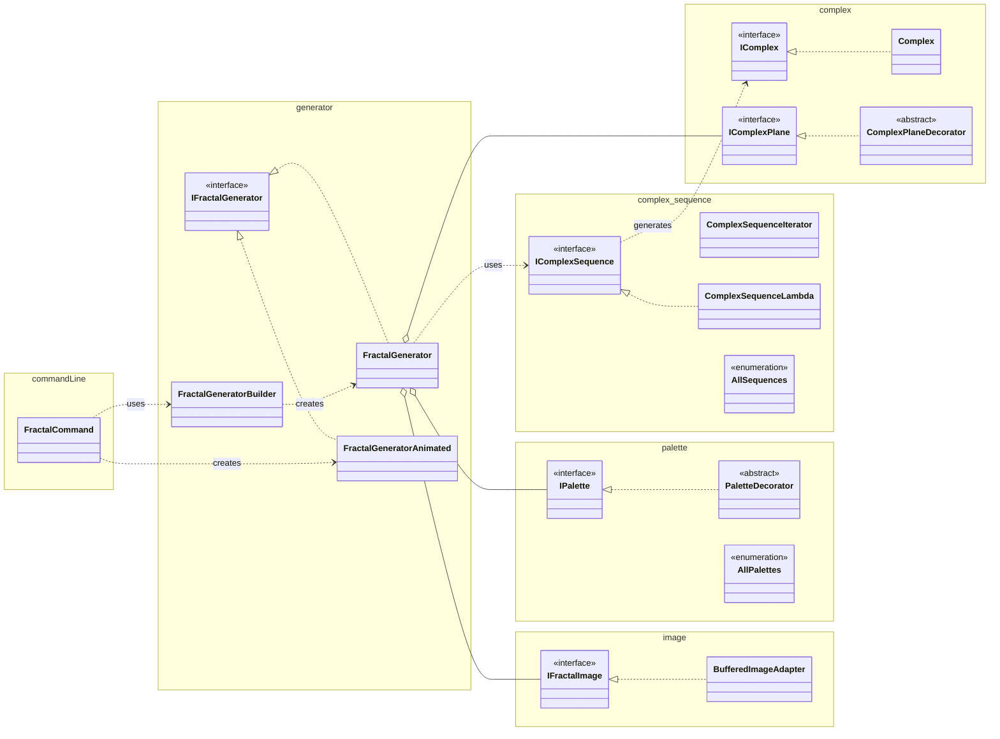
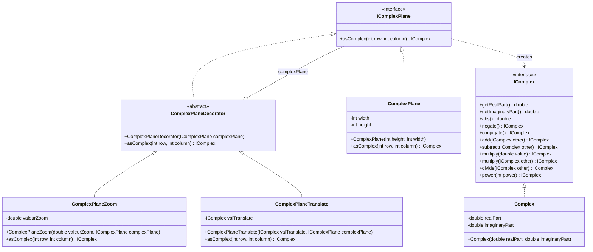
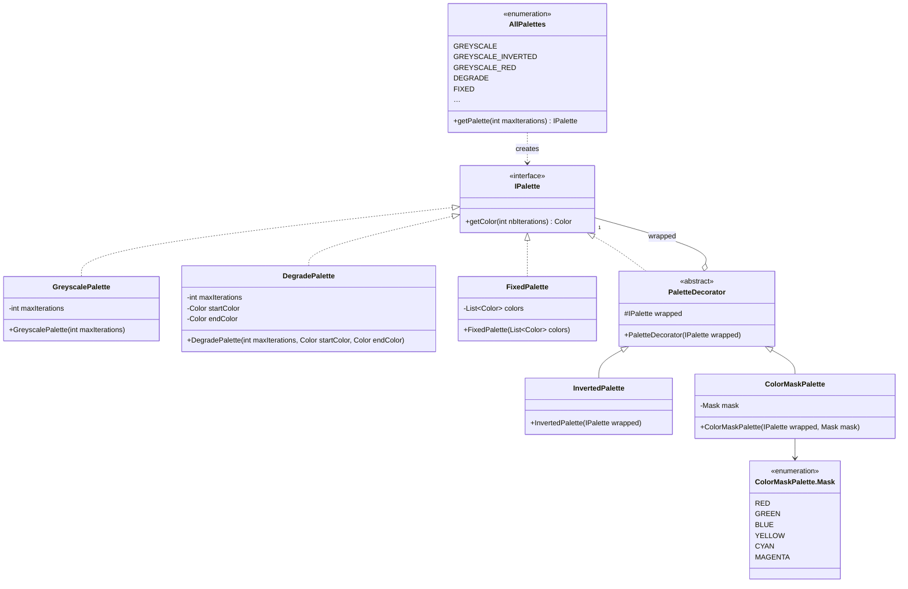
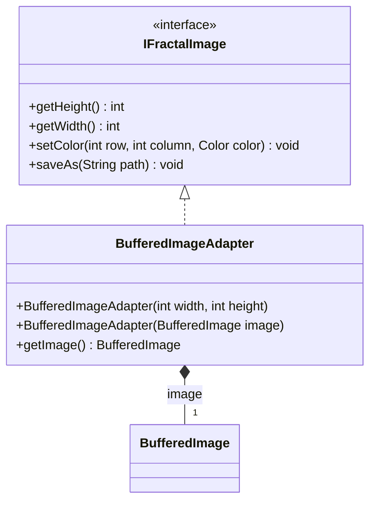
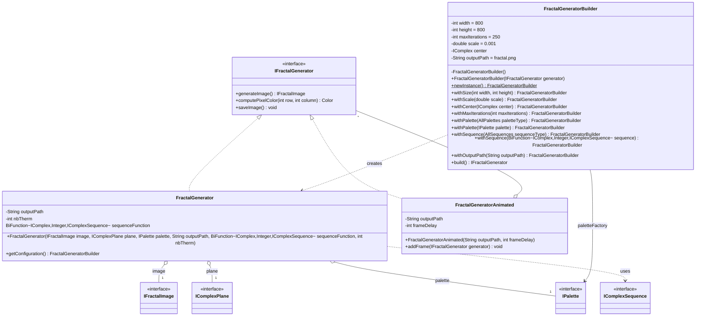
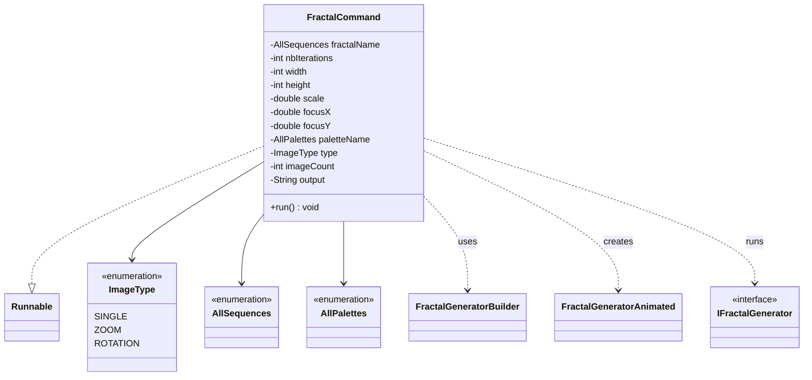

# FractaLens - A Fractal Generator Library Developed in Lens.

This project provides a *Java* library for generating fractal images.
It allows users to choose from a variety of complex sequences, including the
Julia set, Mandelbrot set, and other generalized sequences, to create
static or animated fractal images using different color palettes and
transformations.

## Build and run

The project uses *Java 25* and *Gradle* (through the provided wrapper).

```bash
./gradlew build      # compiles the library and runs the unit tests
./gradlew test       # runs the unit tests and produces the JaCoCo coverage report
./gradlew run --args="-f MANDELBROT -o mandelbrot.png"   # generates a fractal from the command line
```

### Command line

The application is a command-line program (built with *picocli*): the fractal to
generate is chosen with `-f`, and the result is saved in the file given with `-o`.

```bash
# A single image of the Burning Ship fractal, centered in -1.755 - 0.03i
./gradlew run --args="-f BURNING_SHIP -x -1.755 -y -0.03 -s 0.0001 -n 64 -w 800 -h 800 -p DEGRADE -o ship.png"

# An animated GIF zooming on the Mandelbrot fractal (30 images)
./gradlew run --args="-f MANDELBROT -t ZOOM -i 30 -o zoom.gif"

# An animated GIF in which the constant of Julia's sequence rotates
./gradlew run --args="-f JULIA -t ROTATION -i 36 -o julia.gif"
```

| Option                  | Description                                                           | Default     |
|-------------------------|-----------------------------------------------------------------------|-------------|
| `-f`, `--fractal-name`  | The fractal to generate (a value of `AllSequences`). **Required.**   |             |
| `-o`, `--output`        | The file in which the fractal is saved (a GIF file for animations). **Required.** |  |
| `-n`, `--nb-iterations` | The maximum number of iterations.                                     | `250`       |
| `-w`, `--width`         | The width of the image, in pixels.                                    | `800`       |
| `-h`, `--height`        | The height of the image, in pixels.                                   | `600`       |
| `-s`, `--scale`         | The scale (zoom) applied to the complex plane.                        | `0.004`     |
| `-x`, `--focus-x`       | The real part of the center of the image.                             | `0`         |
| `-y`, `--focus-y`       | The imaginary part of the center of the image.                        | `0`         |
| `-p`, `--palette-name`  | The color palette (a value of `AllPalettes`).                         | `GREYSCALE` |
| `-t`, `--type`          | The type of image: `SINGLE`, `ZOOM` or `ROTATION`.                    | `SINGLE`    |
| `-i`, `--image-count`   | The number of images of an animation (at least 2).                    | `30`        |
| `--help`                | Shows the help message.                                               |             |

The `ROTATION` type is only available for `JULIA` and `JULIA_GENERALIZED`.

The coverage report is generated in `build/reports/jacoco/test/html/index.html`.

## Overview

The library is split into six packages.
Each package is built around one or two design patterns, summarized below.



Packages and their patterns: `complex` (Decorator), `complex.sequence` (Template Method + Iterator + Strategy), `palette` (Strategy + Decorator), `image` (Adapter), `generator` (Strategy + Builder + Composite), `commandLine` (Builder).

### Complex numbers and complex plane

A pixel of the image is associated with a complex number by an `IComplexPlane`.
The default plane (`ComplexPlane`) centers the image on 0; it can then be
*decorated* to zoom on it (`ComplexPlaneZoom`) or to move its center
(`ComplexPlaneTranslate`).
Decorators can be stacked: the builder wraps a zoom inside a translation.

**Pattern: Decorator.** Each decorator implements `IComplexPlane`, holds the plane
it decorates, delegates `asComplex()` to it and transforms the result.
Adding a new transformation (e.g. a rotation of the plane) only requires a new
decorator, without modifying the existing classes.



### Complex sequences

A complex sequence is defined by its first term `z0` and by the way the next
term is computed from the previous one (`computeNext()`).
The generator only needs to *count* the terms of the sequence before it
diverges (modulus greater than 2) or reaches the maximum number of terms.

**Pattern: Template Method + Iterator.** `ComplexSequenceIterator` contains the
common iteration algorithm (`hasNext()` checks the divergence criterion,
`next()` calls `computeNext()`), whereas each sequence only provides the
variable step `computeNext()`.
Since `IComplexSequence` extends `Iterable<IComplex>`, any sequence can be
traversed with a `for-each` loop.

**Pattern: Strategy.** `ComplexSequenceLambda` receives the formula of the
sequence as a `BinaryOperator<IComplex>`, so a new sequence can be defined with
a lambda expression instead of a new class.
The `AllSequences` enumeration gathers the predefined sequences and gives, for
each of them, a factory `BiFunction<IComplex, Integer, IComplexSequence>`
(pixel → sequence) that can be passed to the builder.

| Constant                   | Formula                                   | Role of the pixel `z0`             |
|----------------------------|-------------------------------------------|------------------------------------|
| `JULIA`                    | `z² + c`, with `c = -0.4 + 0.6i`          | first term of the sequence         |
| `JULIA_GENERALIZED`        | `z³ + c`, with `c = 0.285 + 0.01i`        | first term of the sequence         |
| `MANDELBROT`               | `z² + z0`                                 | constant added at each step        |
| `MANDELBROT_GENERALIZED`   | `z³ + z0`                                 | constant added at each step        |
| `BURNING_SHIP`             | `(abs(Re z) + i·abs(Im z))² + z0` | constant added at each step        |
| `BURNING_SHIP_GENERALIZED` | `(abs(Re z) + i·abs(Im z))³ + z0` | constant added at each step        |
| `TRICORN`                  | `conjugate(z)² + c`, with `c = -0.4 + 0.6i` | first term of the sequence       |
| `TRICORN_GENERALIZED`      | `conjugate(z)³ + c`, with `c = 0.285 + 0.01i` | first term of the sequence     |

For the Julia-like sequences, the pixel is the first term and `c` is fixed: the
image shows which starting points stay bounded. For the Mandelbrot-like sequences
(Mandelbrot and Burning Ship), the pixel is the constant itself: the image shows
which constants give a bounded sequence.

`JuliaRotation` and `JuliaRotationGeneralized` build the factories of the images
of a rotation animation: the constant `c` of Julia's sequence is multiplied by
`e^(iθ)`, with `θ` going through a full turn.

```mermaid
classDiagram
class Iterable~IComplex~ {
    <<interface>>
}
class Iterator~IComplex~ {
    <<interface>>
}
class IComplexSequence {
    <<interface>>
    +computeNext(IComplex previous) IComplex
}
class ComplexSequenceIterator {
    -IComplex actual
    -int maxIterations
    -int count
    +ComplexSequenceIterator(IComplexSequence sequence, IComplex actual, int maxIterations)
    +hasNext() boolean
    +next() IComplex
}
class ComplexSequenceLambda {
    -BinaryOperator~IComplex~ function
    -IComplex z0
    -int nbTerms
    +computeNext(IComplex previous) IComplex
    +iterator() Iterator~IComplex~
}
class JuliaRotation {
    +rotate(IComplex c, double theta) IComplex$
    +angles(double step) List~Double~$
    +factories(IComplex c, double step) List~BiFunction~IComplex,Integer,IComplexSequence~~$
}
class JuliaRotationGeneralized {
    +isSupported(AllSequences sequence) boolean$
    +factories(AllSequences sequence, IComplex c, double step) List~BiFunction~IComplex,Integer,IComplexSequence~~$
}
class ComplexSequenceJulia
class ComplexSequenceGeneralJulia
class ComplexSequenceMandelbrot
class ComplexSequenceMandelbrotGeneralized
class ComplexSequenceBurningShip
class ComplexSequenceGeneralizedBurningShip
class ComplexSequenceTricorn
class ComplexSequenceTricornGeneralized
class AllSequences {
    <<enumeration>>
    JULIA
    JULIA_GENERALIZED
    MANDELBROT
    MANDELBROT_GENERALIZED
    BURNING_SHIP
    BURNING_SHIP_GENERALIZED
    TRICORN
    TRICORN_GENERALIZED
    +getSequenceFactory() BiFunction~IComplex,Integer,IComplexSequence~
}
Iterable <|-- IComplexSequence
Iterator <|.. ComplexSequenceIterator
ComplexSequenceIterator o-- "1" IComplexSequence : sequence
IComplexSequence <|.. ComplexSequenceLambda
IComplexSequence <|.. ComplexSequenceJulia
IComplexSequence <|.. ComplexSequenceGeneralJulia
IComplexSequence <|.. ComplexSequenceMandelbrot
IComplexSequence <|.. ComplexSequenceMandelbrotGeneralized
IComplexSequence <|.. ComplexSequenceBurningShip
IComplexSequence <|.. ComplexSequenceGeneralizedBurningShip
IComplexSequence <|.. ComplexSequenceTricorn
ComplexSequenceLambda <|-- ComplexSequenceTricornGeneralized
IComplexSequence ..> ComplexSequenceIterator : creates
AllSequences ..> ComplexSequenceLambda : creates
AllSequences ..> ComplexSequenceBurningShip : creates
AllSequences ..> ComplexSequenceGeneralizedBurningShip : creates
JuliaRotation ..> ComplexSequenceJulia : creates
JuliaRotationGeneralized ..> JuliaRotation : uses
JuliaRotationGeneralized ..> ComplexSequenceGeneralJulia : creates
JuliaRotationGeneralized ..> AllSequences : uses
```



### Color palettes

A palette associates a number of iterations with a color.

**Pattern: Strategy.** `GreyscalePalette`, `DegradePalette` (gradient between two
colors) and `FixedPalette` (one color per number of iterations) are
interchangeable implementations of `IPalette`: the generator does not know
which one it uses.

**Pattern: Decorator.** `PaletteDecorator` wraps another palette and modifies its
colors: `InvertedPalette` inverts them, `ColorMaskPalette` only keeps some of
their components (red, green, blue, yellow, cyan or magenta).
Decorators can be combined, e.g. a masked inverted gradient.

The `AllPalettes` enumeration lists every combination
*base palette × decorators* (42 constants), and creates the corresponding
palette from the maximum number of iterations.



### Images

**Pattern: Adapter.** The library manipulates images through its own interface
`IFractalImage`. `BufferedImageAdapter` adapts the `BufferedImage` class of the
Java standard library to this interface, so that the rest of the code does not
depend on AWT. The output format (PNG by default) is deduced from the extension
of the file.



### Fractal generation and configuration

`FractalGenerator` computes the color of each pixel: it converts the pixel into
a complex number with the plane, builds the sequence of this pixel, counts its
terms and asks the palette for the matching color.

**Pattern: Strategy.** The generator is configured with interchangeable
objects: the plane, the palette, the image and the function creating the
sequence of each pixel.

**Pattern: Builder.** `FractalGeneratorBuilder` provides a default value for
every parameter and fluent `withXxx()` methods to change them, checking their
validity. `build()` assembles the decorated plane, the image and the generator.
A generator created by the builder remembers its configuration: a new builder
can be created from it (`new FractalGeneratorBuilder(generator)`) to derive
another generator that only differs by a few parameters (e.g., the scale).

**Pattern: Composite.** `FractalGeneratorAnimated` is itself an `IFractalGenerator`
that contains other generators (its frames). Generating it generates every
frame, and saving it writes all the frames in a single animated GIF file.
Thus, the code using a generator does not need to know whether it produces a
single image or an animation. Two kinds of animations are provided by the command
line: a *zoom* (the scale of each frame is a fraction of the previous one) and a
*rotation* (the constant of Julia's sequence rotates from one frame to the next).



### Command line

`FractalCommand` (package `commandLine`) reads the options given by the user with
*picocli* and configures a `FractalGeneratorBuilder` with them. According to the
requested type of image, it then returns either the generator built by the builder
(`SINGLE`), or a `FractalGeneratorAnimated` whose frames are generators derived
from the same builder (`ZOOM` and `ROTATION`). Invalid parameters (e.g., a
rotation of a sequence that is not Julia's) are reported to the user with a usage
error instead of a stack trace.



## Feature list

| Features                                               | Design Pattern(s)          | Status      | Author(s)        |
|--------------------------------------------------------|----------------------------|-------------|------------------|
| Complex number                                         |                            | Done        | Marie Tiers      |
| Default complex plane                                  | Decorator                  | Done        | Thibault Breguet |
| Scaled complex plane                                   | Decorator                  | Done        | Thibault Breguet |
| Translated complex plane                               | Decorator                  | Done        | Théo Brureau     |
| Sequence of complex numbers                            | Template method            | Done        | Théo Brureau     |
| Iterator over a sequence of complex numbers            | Iterator                   | Done        | Joan Pesson      |
| Julia sequence                                         | Strategy                   | Done        | Théo Brureau     |
| Mandelbrot sequence                                    | Strategy                   | Done        | Joan Pesson      |
| Multijulia sequence                                    | Strategy                   | Done        | Thibault Breguet |
| Multibrot sequence                                     | Strategy                   | Done        | Joan Pesson      |
| Burning Ship sequence (and generalized version)        | Strategy                   | Done        | Théo Brureau     |
| Tricorn sequence (and generalized version)             | Strategy                   | Done        | Marie Tiers      |
| Generic sequences (defined by a lambda expression)     | Strategy                   | Done        | Théo Brureau     |
| Enumeration of the available sequences                 | Strategy                   | Done        | Thibault Breguet |
| Color palette                                          | Strategy                   | Done        | Marie Tiers      |
| Grey scale palette                                     | Strategy                   | Done        | Marie Tiers      |
| Red/Green/Blue/... scale palette                       | Decorator                  | Done        | Marie Tiers      |
| Inverted color palette                                 | Decorator                  | Done        | Joan Pesson      |
| Gradient-based color palette                           | Strategy                   | Done        | Théo Brureau     |
| Predefined color palette                               | Strategy                   | Done        | Théo Brureau     |
| Enumeration of the available palettes                  | Strategy + Decorator       | Done        | Marie Tiers      |
| `BufferedImage` used as an `IFractalImage`             | Adapter                    | Done        | Théo Brureau     |
| Static image generation                                | Strategy                   | Done        | Théo Brureau     |
| Configuration of the fractal generator                 | Strategy + Builder         | Done        | Théo Brureau     |
| Composite of fractal generators (animated GIF)         | Composite                  | Done        | Théo Brureau     |
| Scale-based animated image generation                  | Composite + Builder        | Done        | Thibault Breguet |
| Rotation-based animated image generation               | Composite + Builder        | Done        | Marie Tiers      |
| Command-line interface                                 | Abstract factory + Builder | Done        | Joan Pesson      |

## Team

This project has been developed by:

- Brureau Théo
- Pesson Joan
- Breguet Thibault
- Tiers Marie